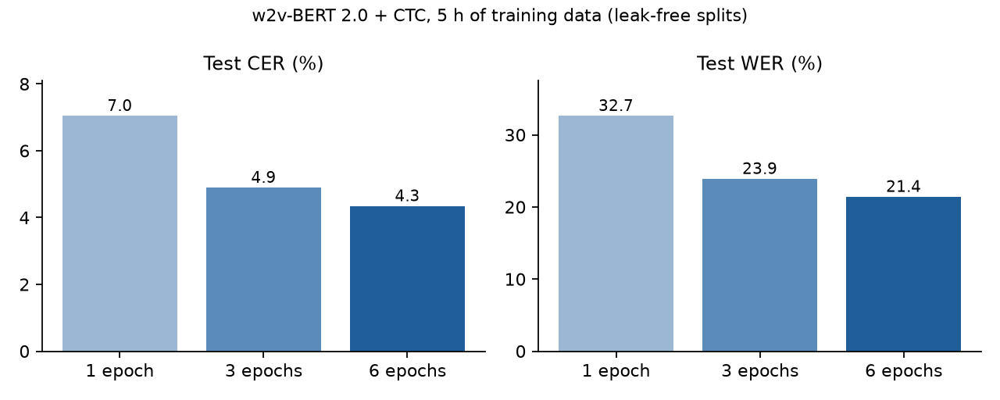

# Persian ASR — w2v-BERT 2.0 CTC with leakage-audited evaluation

Low-resource Persian speech recognition: fine-tuning **w2v-BERT 2.0** (a 600M-parameter encoder pretrained on
4.5M hours of speech) with a character-level **CTC** head on just **5 hours** of Common Voice Persian, trained
and evaluated on a single 16 GB laptop GPU.

The part I'm proudest of is not the number, it's the **evaluation audit**: an earlier iteration of this project
reported a very good score that turned out to be inflated by data leakage and an unfair scorer. This repo fixes
that and reports honest numbers with confidence intervals.

## Results

Test set: 1,564 held-out Common Voice Persian utterances (~2 h). Training: 5 h, leak-free splits (see below).
Scoring: CER / WER after removing punctuation and diacritics and mapping ZWNJ to a space, applied to both
hypothesis and reference. 95% CIs are utterance-level bootstrap.

| Model | Train data | Epochs | Test CER | Test WER |
|---|---|---|---|---|
| w2v-BERT 2.0 + CTC | 5 h | 1 | 7.05% | 32.7% |
| w2v-BERT 2.0 + CTC | 5 h | 3 | 4.90% | 23.9% |
| **w2v-BERT 2.0 + CTC** | **5 h** | **6** | **4.35%** (4.13–4.53) | **21.4%** (20.5–22.3) |

Raw metrics, per-utterance predictions and training logs are in [`results/`](results/). Dev error was still
falling at epoch 6, so these numbers are not converged. No Whisper baseline has been re-run under the corrected
setup yet, so this repo makes **no claim of beating Whisper** (see roadmap).



### What the remaining errors look like
The first six erroneous 5–9-word test utterances in the file (not cherry-picked; 515 of 1,564 utterances, 32.9%,
are word-for-word exact):

| Reference | Model output |
|---|---|
| غیرت ما کجا رفته صداها شدیدتر می شود | غیرت ما کجا رفته صداها شدیدتر میشود |
| شما به چی مشکوک نیستی | شما به چی مشبود نیستی |
| تو کتاب جانور شناسیمون نوشته | تو کتاب جانورشناسیمون نوشته |
| ببین پلاستیک کفشهام از اقیانوس بازیافت شده | ببین پلاستیک کفش هایم از وقیانیز بازیافت شده |
| بچه ها ببینید چی گرفتم | بچا ا ببینید چی گرفتم |
| اگر انسان هستیم آشغال نریزیم در طبیعت | اگر انسان هستیم مشغل نرزیم در طبیعت |

Two families dominate: **orthographic spacing variants** (می شود / میشود, جانور شناسی / جانورشناسی), which are
arguably not errors, and **acoustically confusable or rare words**, where an n-gram language model should help.

## What the audit found (and fixed)

| Problem in the first iteration | Effect | Fix |
|---|---|---|
| **Sentence leakage**: every test sentence also appeared in the training data (different clips of the same text) | Inflated scores, flat data-efficiency curves | `scripts/make_clean_splits.py`: sentence-disjoint, nested, seeded splits (test set kept frozen) |
| **Scorer penalised punctuation / ZWNJ** | Seq2seq models (Whisper) unfairly disadvantaged vs CTC | `normalize_for_scoring` on both sides |
| **Warm start from a checkpoint already fine-tuned on Common Voice** | Possible test contamination | Train from the pretrained base only |
| Broken split helpers (one utterance per "budget") | Training silently used almost no data | Replaced by `nested_budget_splits` |
| No saved predictions | Runs could not be re-scored | Every evaluator writes per-utterance JSONL; bootstrap CIs |

Full write-up: [`docs/PLAN.md`](docs/PLAN.md). Older numbers are kept in `docs/archive/` marked superseded.

## Quick start

```bash
pip install -r requirements.txt
python scripts/make_clean_splits.py            # needs data/splits/ manifests (see scripts/prepare_data.py)
python scripts/train.py --config configs/w2v_bert2.yaml --mode w2vbert_ctc --budget_hours 5
python scripts/transcribe.py --ckpt outputs/checkpoints/budget_5h_w2vbert_ep6 clip.wav
```

Training is resumable in segments (`training.max_epochs_this_run`, `training.resume`) so it fits laptop-class
hardware. 5 h × 6 epochs ≈ 1.5 h on an RTX 3080 Ti Laptop (8-bit AdamW, bf16, gradient checkpointing,
batch 4 × accumulation 8).

## Layout

```
configs/          model + experiment YAML
scripts/          prepare_data, make_clean_splits, train, transcribe, eval_*, build_lm, fetch_naab
src/persian_asr/  data (splits, normalisation), train (w2v-BERT CTC, Whisper, XLS-R), evaluate, decode
results/          metrics, predictions, logs for the reported runs
tests/            unit tests (scorer, vocab/decode, tiny-model forward/backward, bootstrap CI)
docs/             plan + audit, literature notes, archived superseded results
```

## Roadmap

- [x] Leak-free splits, fair scorer, bootstrap CIs, resumable w2v-BERT CTC training, inference CLI
- [ ] Re-baseline Whisper-large-v3 / large-v3-turbo on the same splits and scorer
- [ ] KenLM 4-gram shallow fusion (code in `src/persian_asr/decode`, corpus tooling in `scripts/`; LM not yet built)
- [ ] Data-efficiency curve (5 / 10 / 25 / 50 h) and longer training
- [ ] Pseudo-labelling on unlabelled audio

## Limitations

- Read speech (Common Voice) from one corpus; **not** a dialect or conversational-speech benchmark.
- Speaker-disjointness of train and test cannot be verified (no speaker IDs in the manifests).
- Single run per setting; the confidence intervals reflect test-set sampling, not seed variance.

## Data & licences

Common Voice Persian (CC0) via the `kiarashQ/farsi-asr-unified-cleaned` mirror. Model: `facebook/w2v-bert-2.0`
(MIT). Code in this repo: MIT (see `LICENSE`). The optional naab corpus used for LM experiments has an
ambiguous licence (MIT vs CC BY-NC-SA 4.0) — check before commercial use.
